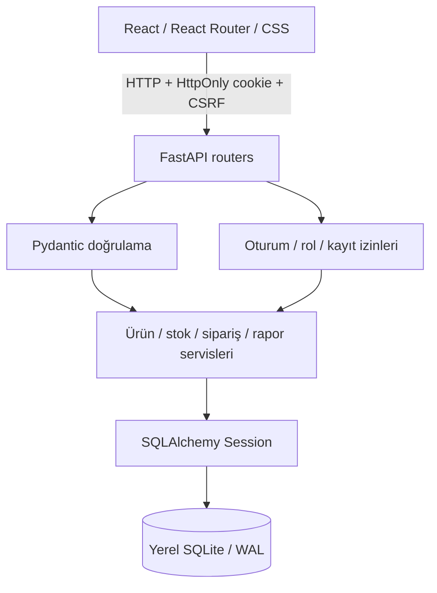
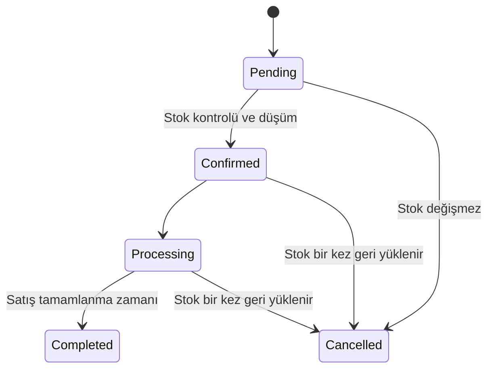

# StockPilot mimarisi

## Veri akışı

Frontend veritabanına doğrudan erişmez. UI toplamları yalnızca önizlemedir; kaynak doğruluğu, fiyatlar ve stok kararları backend'e aittir. Yerel çalışma için build edilmiş React uygulaması FastAPI'den sunulur. Geliştirmede Vite `/api` ve `/uploads` proxy'si kullanılır.

## Backend sınırları

`api/` HTTP metotlarını, request modellerini ve sonuç serileştirmeyi tanımlar. `schemas/` fazla alanları reddeder, sayı/uzunluk/aralık kurallarını uygular. `dependencies/` istek başına SQLAlchemy Session oluşturur ve oturum/izinleri doğrular. `services/` stock/order/auth business kurallarını ve audit kayıtlarını içerir. `models/` foreign key, unique, index ve check constraint'lerini tanımlar.

Veri işleme senkron SQLAlchemy ile FastAPI worker thread'lerinde yapılır. Ağ veritabanı/asenkron sürücü gerekmez. Her istek kendi Session'ını kullanır; Session thread'ler arasında paylaşılmaz.

## İstek transaction'ı

1. Yazma isteği önce Origin ve boyut kontrolünden geçer.
2. `get_db`, bağlantıya `sqlite_write=True` execution option'ı verir.
3. Engine'in begin event'i `BEGIN IMMEDIATE` çalıştırır; yazıcı kilidi **yetki/ürün/sipariş okunmadan önce** alınır.
4. Oturum ve CSRF doğrulanır. İlgili endpoint rol/işlem izni ve gerektiğinde kayıt sahibini denetler.
5. Servis verileri okur, kuralları kontrol eder, değişiklikleri flush eder.
6. `Depends(..., scope="function")` dependency'si yanıt gönderilmeden önce commit yapar. Her istisna rollback yapar.

SQLite bağlantılarında `foreign_keys=ON`, `journal_mode=WAL`, `busy_timeout=15000` etkindir. Okuma transaction'ları `BEGIN` kullanır. WAL, okuyucuların yazıcıyla birlikte ilerlemesine yardımcı olur; SQLite hâlâ aynı anda tek yazıcıya izin verir. Bekleyen yazıcı 15 saniyede kilit alamazsa istemciye yeniden denemeye uygun 503 hatası döner. Çok yüksek yazma hacmi için yatay ölçek iddiası yoktur.

## Sipariş ve stok kuralları

- Bir sipariş en az 1, en fazla 100 farklı ürün içerir. Tekrarlanan product_id reddedilir.
- Müşteri aktif, ürün arşivlenmemiş olmalıdır. Siparişi oluştururken ürünün güncel satış fiyatı kullanılır. İstemciden `total` veya `unit_price` kabul edilmez.
- Tutarlar integer kuruştur. Satır toplamı `quantity * unit_price`; sipariş toplamı satır toplamlarıdır. Sipariş tutarı en fazla 1 milyar TL olabilir.
- Sipariş kaleminde ürün adı, SKU, kategori adı ve birim fiyat snapshot olarak saklanır. Katalog değişiklikleri geçmişi değiştirmez. Bekleyen sipariş düzenlenirken fiyatlar güncel katalogdan yeniden alınır.
- Yalnızca `Pending` düzenlenebilir. Onay sırasında önce **tüm satırların** stokları kontrol edilir; sonra stoklar ve hareketler aynı transaction'da yazılır.
- `stock_deducted` iptalde stok geri yükleme kararını kaydeder. `Confirmed` veya `Cancelled` durumuna yeniden gönderilen aynı istek no-op'tur. Eşzamanlı istekler yazıcı kilidi nedeniyle güncel durumu sırayla okur.
- `Completed` ve `Cancelled` son durumlardır. Tamamlanan siparişte iptal/iade yoktur; ayrı bir satış iade modülü bu kapsamda bulunmaz.
- Arşivlenen ürün mevcut siparişlerde/snapshot'larda korunur. Onaylanmış siparişin iptali, ürün sonradan arşivlense de stoğu geri yükler.
- Stok düzeltme girdisi delta değil **yeni gerçek toplamdır**. Servis farkı hesaplar ve audit hareketini kaydeder. Değişmeyen/negatif bakiye üreten işlem reddedilir.

## Kimlik doğrulama

Kayıtlar `users` tablosundadır. Argon2id hash'i dışında parola tutulmaz. İlk admin yalnızca etkileşimli CLI üzerinden, kullanıcıdan alınan parola ile oluşturulur. Public kayıt varsayılan kapalıdır; açıkken sadece onay bekleyen çalışan oluşturur.

Login 48 byte rastgele token ve 32 byte rastgele CSRF token üretir. Session token'ın SHA-256 özeti `sessions` tablosunda tutulur, aslı `HttpOnly`, `SameSite=Lax`, production'da `Secure` cookie'ye yazılır. CSRF değeri login veya `/auth/me` yanıtında döner ve frontend belleğinde tutulur. Token localStorage'a yazılmaz.

Kimlik doğrulanmış tüm değişiklik istekleri `X-CSRF-Token` ve izin verilen tam Origin gerektirir. Login/register da Origin kontrolündedir. CORS yalnızca açık adreslere credentials izni verir. Bir endpoint'teki görünmez buton hiçbir zaman backend yetkisini değiştirmez.

Admin tüm kayıtları yönetir. Çalışan ürün/stok/sipariş izinlerine göre değişiklik yapar ve sadece kendi siparişlerini okuyup değiştirebilir. Müşteriler, ürünler ve tedarikçiler tek işletmenin ortak kayıtlarıdır. Dashboard sipariş/satış istatistikleri çalışan için kendisine aittir; stok/katalog istatistikleri işletme genelidir. Raporlar yalnızca admin içindir.

Login/kayıt limiti veritabanında saklanır; thread/süreç değişiminde sıfırlanmaz. Başarısız login JSONResponse olarak döner, böylece başarısız deneme kaydı transaction rollback'iyle kaybolmaz. Cookie geçersiz/expired ya da kullanıcı pasifse erişim 401 döner. Parola/rol/durum/izin değişimleri sunucu tarafında oturumları iptal eder.

## Tablolar ve ilişkiler

| Tablo | Amaç ve temel bağlantı |
| --- | --- |
| users | Kullanıcı, benzersiz e-posta, Argon2 hash, rol/durum/izin |
| sessions | Kullanıcıya bağlı token özeti, CSRF ve expiry |
| login_attempts | Hash'lenmiş IP/e-posta anahtarları ve deneme zamanı |
| categories | Benzersiz kategori adı |
| suppliers | Tedarikçi iletişimi ve aktiflik |
| customers | Müşteri iletişimi ve aktiflik |
| products | Benzersiz SKU, kategori/tedarikçi, integer fiyat/stok, arşiv |
| orders | Müşteri, oluşturan kullanıcı, durum, integer toplam ve completion |
| order_items | Sipariş/ürün bağlantısı, tarihsel fiyat/ad snapshot'ları |
| order_events | Sipariş durumunun kullanıcı/tarih geçmişi |
| stock_movements | Ürün/kullanıcı/sipariş, delta, işlem sonrası bakiye |
| audit_logs | Kullanıcı, işlem, entity/id, zaman; hassas içerik yok |
| settings | İşletme adı, kayıt izni ve seed versiyon işareti |

Şema `backend/alembic/versions/214768e25502_initial_schema.py` ile sürümlenir. Migration `Base.metadata.create_all` çağırmaz; açık tablo/index/constraint işlemleri içerir. `create_all` yalnızca izole unit test fixture'ında kullanılır. E2E veritabanı gerçek migration ile kurulur.

## Rapor semantiği

Dashboard ve raporlar SQL `COUNT`, `SUM`, `GROUP BY` sorgularıyla hesaplanır. Tamamlanan siparişlerin `completed_at` alanı satış tarihidir. Ürün raporunda aynı isimli farklı SKU'lar ayrı tutulur; kategori raporu sipariş anındaki kategori snapshot'ını kullanır. İptal/bekleyen/hazırlanan siparişler satış gelirine dahil değildir. Sipariş durum raporundaki tutarlar durum bazında sipariş değeridir.

CSV tutarları integer kuruş olarak, başlıkta birim belirtilerek üretilir. UTF-8 BOM Türkçe Excel uyumluluğu sağlar. Metin hücrelerinde `=`, `+`, `-`, `@` başlangıçları kaçırılır. Kritik stok raporu tarihsel bakiye rekonstrüksiyonu yapmaz; güncel ürünleri gösterir.

## Frontend ve erişilebilirlik

`services/api.js` fetch, cookie ve CSRF başlıklarını merkezileştirir. `AuthContext` oturum/rol bilgisini, `ToastContext` işlem geri bildirimini yönetir. `useResource` abort edilen/eski istek sonuçlarını işlemez; `useMutation` bekleme ve hata durumunu sağlar. React Router hem korumalı rotaları hem URL'de saklanan liste filtrelerini yönetir.

Formlar native HTML doğrulamasını kullanır; asıl güvenlik Pydantic'tedir. `Field` benzersiz id ile label ve açıklamayı girdiye bağlar. Native `dialog` focus trap, Escape ve modal davranışı sağlar. Mobil sidebar arka planı inert yapar, klavye odağını içinde tutar ve kapanınca önceki odağa döndürür. Tablolar dar ekranlarda kendi alanında yatay kaydırılır; sayfa taşmaz. Temalar CSS değişkenlerinden, hareketler tek bir CSS transform/opacity yaklaşımından gelir. `prefers-reduced-motion` desteklenir.

## Dosyalar, ortamlar ve sınırlar

Görseller dosya sistemi üzerinde, veritabanında yalnızca rastgele isimli URL ile saklanır. Metadata ve gömülü içerik yeniden kodlamayla atılır. Dosya yazma DB transaction'ının parçası değildir; çok nadir commit/disk hataları veya görsel değişimi sahipsiz dosya bırakabilir. Otomatik silme kullanıcı verisini riske atmamak için uygulanmamıştır.

Production modu TLS proxy/sertifika kurmaz; yalnızca güvenli cookie, HTTPS origin doğrulaması ve HSTS politikasını uygular. Lokal geliştirme HTTP üzerinden çalışır. Üretim sunucusuna deploy, dış ağ yük testi, penetrasyon testi ve tüm tarayıcı matrisi bu teslimatta yapılmamıştır.

## Doğrulama yaklaşımı

pytest her test için geçici dosya tabanlı SQLite oluşturur; in-memory SQLite ile gerçek concurrency davranışı taklit edilmez. Thread testleri eşzamanlı aynı/farklı sipariş onayını ve iptalini dener. SQL constraint, rollback, snapshot, rol/CSRF, rapor ve seed tekrarları kontrol edilir.

Playwright gerçek build'i gerçek FastAPI ve migration uygulanmış geçici SQLite ile açar. Login, ürün/stok/sipariş işlemleri, CSV, rotalar, responsive taşma, tema ve klavye akışlarını doğrular. Harici mock servis yoktur. GitHub Actions dosyası bu kontrolleri otomatikleştirmek üzere hazırlanmıştır; uzak CI bu görevde çalıştırılmadı.

Uygulama tasarımında başvurulan birincil kaynaklar: [FastAPI CORS](https://fastapi.tiangolo.com/tutorial/cors/), [FastAPI response cookies](https://fastapi.tiangolo.com/advanced/response-cookies/), [SQLAlchemy SQLite transaction kontrolü](https://docs.sqlalchemy.org/en/20/dialects/sqlite.html), [SQLite transaction kuralları](https://www.sqlite.org/lang_transaction.html).
