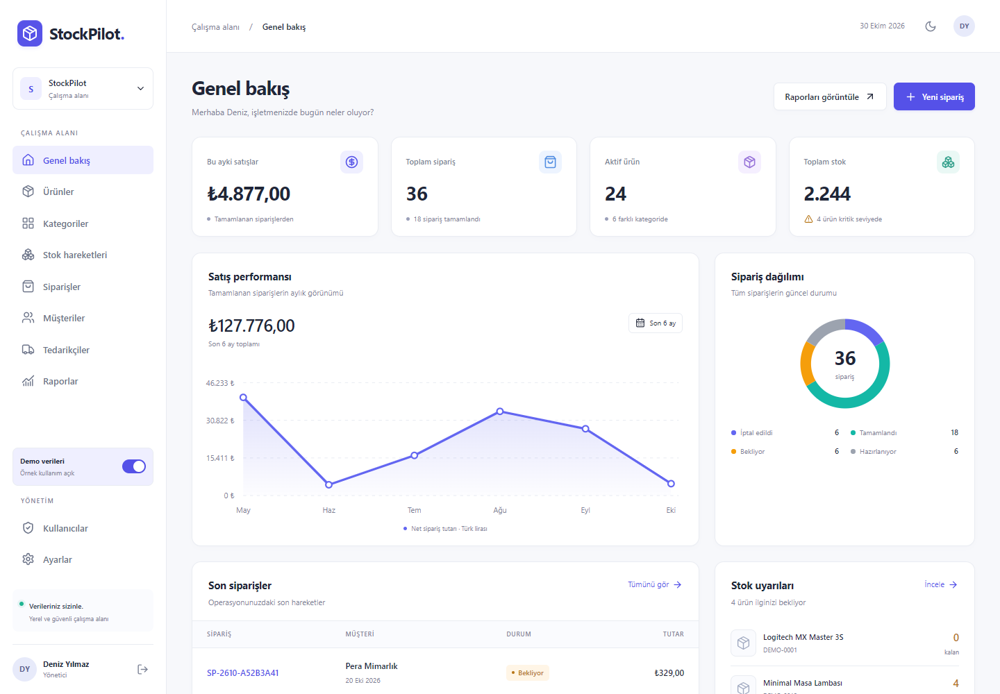

# StockPilot

**Stoklarınız, siparişleriniz ve ekibiniz için tek bir çalışma alanı.**

StockPilot, küçük ve orta ölçekli işletmeler için Türkçe bir stok ve sipariş yönetim uygulamasıdır. React arayüzü gerçek FastAPI endpoint'lerini kullanır; tüm iş kuralları ve veriler yerel SQLite veritabanındadır. API anahtarı, bulut hesabı veya Docker gerekmez.



> Görseller, ayrı ve geçici bir test veritabanında üretilen demo kayıtları gösterir. Asıl veritabanına otomatik demo kullanıcı veya parola eklenmez.

## Özellikler

- **Kimlik ve ekip:** Argon2 parola hashleme, HttpOnly oturum cookie'si, CSRF/Origin kontrolü, giriş hızı sınırlama, profil ve parola güncelleme, yönetici onaylı kayıt, hesap durumu ve işlem izinleri.
- **Dashboard:** gerçek ürün/stok/sipariş sayıları, aylık satışlar, 6 aylık grafik, sipariş/kategori/stok dağılımları, son hareketler, kritik stok ve çok satanlar.
- **Ürünler:** oluşturma, düzenleme, arşivleme/geri alma, benzersiz SKU, kategori/tedarikçi ilişkileri, güvenli görsel yükleme, arama, filtreleme, sıralama, sayfalama ve detay sayfası.
- **Stok:** giriş, çıkış, gerçek sayım miktarına düzeltme, kullanıcı/tarih/açıklama ve işlem sonrası bakiye. Negatif stok engellenir.
- **Siparişler:** müşteriye bağlı çok kalemli sipariş, bekleyen siparişi düzenleme, sunucu tarafı fiyat hesaplama, durum geçmişi, onayda stok düşümü, iptalde bir defalık iade.
- **Müşteri/tedarikçi:** iletişim ve adres bilgileri, aktif/pasif durum, arama ve filtre, müşteri sipariş geçmişi, tedarikçi ürünleri.
- **Raporlar:** günlük/aylık, ürün/kategori satışları, stok hareketleri, kritik stok, sipariş durumları; tarih filtresi ve güvenli CSV.
- **Arayüz:** açık/koyu tema, masaüstü ve mobil navigasyon, modal, bildirimler, boş/hata/yüklenme durumları, klavye erişimi ve azaltılmış hareket desteği.

## Teknolojiler

| Katman | Teknolojiler |
| --- | --- |
| Frontend | React 19, JavaScript/JSX, React Router 7, Vite 6, HTML5, CSS3, Lucide ikonları |
| Backend | Python 3.12, FastAPI, Pydantic 2, SQLAlchemy 2, Alembic, Uvicorn |
| Veri | Yerel SQLite, SQL, WAL, foreign key ve check constraint'ler |
| Güvenlik | Argon2id, rastgele opaque session token, HttpOnly/SameSite/Secure cookie, CSRF |
| Doğrulama | pytest, HTTPX TestClient, ESLint, Playwright/Chromium |

Frontend uygulama kaynakları yalnızca `.js` / `.jsx` kullanır. TypeScript, Tailwind, harici auth/veritabanı ve Node.js backend yoktur. Paketlerin kendi tip bildirimleri `node_modules` altında bulunabilir; bunlar uygulama kaynak kodu değildir.

## Windows 11 hızlı kurulum

Ön koşullar: **Python 3.12**, **Node.js 24 LTS ve npm**, **Git**. Komutları PowerShell'de `stockpilot` klasöründen çalıştırın.

```powershell
cd "C:\Users\PC\Documents\ChatGPT\Stok Siparis Sistemi\stockpilot"
.\setup.ps1 -Demo
.\start.ps1
```

`setup.ps1`, sanal ortamı ve kilitli bağımlılıkları kurar, frontend'i build eder, migration'ı uygular; ilk kurulumda ad, e-posta ve **gizli parola girişi** ister. `-Demo` yalnızca açıkça istediğinizde 24 ürün, 6 kategori, 8 müşteri, 5 tedarikçi, 36 sipariş ve ilgili stok hareketlerini ekler. Demo istemiyorsanız `-Demo` parametresini kaldırın. İkinci çalıştırmada mevcut yönetici değiştirilmez; seed çoğaltılmaz.

PowerShell script çalıştırmayı engellerse sistem politikasını kalıcı değiştirmek yerine aşağıdaki manuel komutları kullanabilirsiniz.

Başlatınca uygulama [http://127.0.0.1:8000](http://127.0.0.1:8000), Swagger [http://127.0.0.1:8000/docs](http://127.0.0.1:8000/docs) adresinde açılır. `start.ps1` build edilmiş React dosyalarını **FastAPI üzerinden** sunar; tek sunucu yeterlidir. Durdurmak için `Ctrl+C`. Kaynak değişikliklerinden sonra `start.ps1 -Rebuild` kullanın.

## Manuel kurulum

```powershell
# stockpilot klasöründe
python -m venv .venv
.\.venv\Scripts\python.exe -m pip install -r backend\requirements.lock.txt

cd backend
..\.venv\Scripts\python.exe -m alembic upgrade head
..\.venv\Scripts\python.exe -m scripts.create_admin
# İsteğe bağlı demo verisi; önce yönetici oluşturulmalı:
..\.venv\Scripts\python.exe -m scripts.seed
cd ..\frontend
npm ci
npm run build
cd ..
.\start.ps1
```

Aktivasyon zorunlu değildir; komutlar doğrudan sanal ortamdaki Python'ı çağırır. `requirements.txt` kabul edilen sürüm aralıklarını, `requirements.lock.txt` bu teslimatta test edilen tam sürümleri içerir. Frontend için `package-lock.json` kullanılır.

### İlk yönetici ve yeni çalışanlar

Hazır demo parolası yoktur. `scripts.create_admin` parolayı `getpass` ile alır; terminale/loga yazmaz ve düz metin kaydetmez. En az 12 karakter gerekir. Kendi e-posta/parolanızla giriş yapın.

Yönetici, **Ayarlar → Çalışma alanı → Hesap başvurularına izin ver** seçeneğini açabilir. Demo kurulumu bu seçeneği açar; boş kurulumda kapalıdır. Kayıt olan kişiler `employee/pending` olarak oluşur ve yönetici **Kullanıcılar** ekranından aktif etmedikçe giriş yapamaz. Kullanıcı oluştururken rol veya durum göndermek reddedilir.

Çalışanlar ürün ve stokları okuyabilir; ürün yönetimi varsayılan kapalı, stok ve sipariş yönetimi varsayılan açıktır. Yönetici izinleri ayrı ayrı değiştirebilir. Çalışanlar yalnızca kendi siparişlerini görür/yönetir. Raporlar, kullanıcı yönetimi ve işletme ayarları yöneticiye özeldir. Yetki değişikliği kullanıcının mevcut oturumlarını iptal eder.

## Geliştirme: ayrı frontend ve backend

İki PowerShell penceresi kullanın:

```powershell
# Pencere 1 — stockpilot/backend
..\.venv\Scripts\python.exe -m uvicorn app.main:app --host 127.0.0.1 --port 8000 --reload
```

```powershell
# Pencere 2 — stockpilot/frontend
npm install
npm run dev
```

Frontend [http://127.0.0.1:5173](http://127.0.0.1:5173) üzerinde çalışır. Vite, `/api` ve `/uploads` isteklerini FastAPI'ye proxy eder. Tarayıcıda aynı hostname'i kullanın; `localhost` ile `127.0.0.1` arasında geçiş farklı cookie alanları oluşturur. Tarayıcıda hiçbir veritabanı işlemi veya mock API yoktur.

## Veritabanı ve migration

Varsayılan dosya `backend/data/stockpilot.db` konumundadır. `alembic upgrade head`, klasörü/dosyayı oluşturur ve sürümlü şemayı kurar. Uygulama başlangıcında tablo sıfırlama, `create_all` veya seed çalıştırılmaz.

```powershell
cd backend
..\.venv\Scripts\python.exe -m alembic current
..\.venv\Scripts\python.exe -m alembic check
# İleride model değiştirildiğinde:
..\.venv\Scripts\python.exe -m alembic revision --autogenerate -m "aciklayici migration adi"
# Üretilen migration dosyasını inceleyin, sonra:
..\.venv\Scripts\python.exe -m alembic upgrade head
```

Şema: `users`, `sessions`, `login_attempts`, `categories`, `products`, `suppliers`, `customers`, `stock_movements`, `orders`, `order_items`, `order_events`, `audit_logs`, `settings`.

Tüm parasal değerler **integer kuruş** olarak saklanır ve API'de taşınır (`12550` = `125,50 TL`). Tarihler veritabanında UTC'dir; arayüz kullanıcının saat diliminde gösterir. Tarih filtreleri UTC gün sınırlarını kullanır. Satış raporları yalnızca tamamlanan siparişleri `completed_at` üzerinden toplar. Kritik stok raporu güncel stok görüntüsüdür; tarih filtresi ürünün oluşturulma tarihine uygulanır, geçmiş stok anlık görüntüsü değildir.

SQLite WAL ve 15 saniye busy timeout kullanılır. Yazma istekleri stok/durum okunmadan önce `BEGIN IMMEDIATE` ile kilit alır. Stok, sipariş durumu, hareketler ve audit kaydı birlikte commit/rollback olur. Ayrıntılar [ARCHITECTURE.md](ARCHITECTURE.md) içinde.

Yedekleme için sunucuyu düzgünce kapattıktan sonra `data/` ve `uploads/` klasörlerini birlikte yedekleyin. Çalışan WAL veritabanının yalnızca `.db` dosyasını kopyalamayın; canlı yedek gerekiyorsa SQLite Backup API kullanın.

## API

Tam endpoint listesi, alanlar ve örnek istek şemaları `/docs` ve `/openapi.json` üzerinden sunulur. Başarılı yanıtlar nesne/dizi; listeler `{ items, total, page, page_size }` yapısındadır. Hatalar `{ error: { code, message, details } }` döndürür.

| Yol | Metot | İşlem |
| --- | --- | --- |
| `/api/auth/login`, `/register`, `/logout`, `/password` | POST | Oturum, başvuru, çıkış, parola |
| `/api/auth/me` | GET | Kullanıcı ve CSRF token |
| `/api/auth/profile` | PATCH | Kendi profilini güncelle |
| `/api/products`, `/api/products/{id}` | GET, POST / GET, PATCH | Ürün listesi/oluşturma/detay/güncelleme |
| `/api/products/{id}/archive`, `/image` | POST | Arşiv/geri alma, görsel |
| `/api/categories`, `/api/categories/{id}` | GET, POST / PATCH | Kategori yönetimi |
| `/api/inventory` | GET, POST | Hareket geçmişi, stok işlemi |
| `/api/orders`, `/api/orders/{id}` | GET, POST / GET, PATCH | Sipariş CRUD |
| `/api/orders/{id}/confirm`, `/cancel`, `/status` | POST | Durum geçişi |
| `/api/customers`, `/api/suppliers` | GET, POST | İletişim listesi ve oluşturma |
| `/api/customers/{id}`, `/api/suppliers/{id}` | GET, PATCH | Detay ve düzenleme |
| `/api/dashboard/summary` | GET | Dashboard agregasyonları |
| `/api/reports/sales`, `/api/reports/export` | GET | Rapor ve CSV |
| `/api/users`, `/api/users/{id}` | GET / PATCH | Ekip ve izinler |
| `/api/settings` | GET, PATCH | İşletme ayarları |
| `/api/audit-logs` | GET | Yönetici işlem günlüğü |
| `/api/health` | GET | Süreç sağlık kontrolü |

JSON/multipart yazma istekleri izin verilen `Origin` başlığını taşımalıdır. Login/register dışındaki yazma istekleri ayrıca `/auth/me` veya login yanıtından gelen `X-CSRF-Token` başlığını ve session cookie'sini kullanır. Swagger ile yazma testi yaparken bu başlıkları ekleyen bir istemci kullanın; `/docs` endpoint ve şema inceleme için hazırdır.

## Test ve doğrulama

```powershell
# stockpilot/backend
..\.venv\Scripts\python.exe -m pytest

# stockpilot/frontend
npm run lint
npm run build
npm run test:e2e
```

E2E mevcut Chrome/Edge'i kullanır. Bunlar yoksa bir kez `npx playwright install chromium` çalıştırın. Test koşucusu portu otomatik seçer, migration ile geçici SQLite kurar, rastgele geçici yönetici parolası üretir, demo verisini yükler, build edilmiş uygulamayı açar ve sonunda sunucuyu kapatır. Sunucunun 180 saniye üst sınırı vardır. **Gerçek uygulama veritabanı kullanılmaz.** Node.js yalnızca test koşucusu/geliştirme aracıdır; HTTP backend Python'dır.

Test kapsamı: giriş/hatalı parola/çıkış/oturum süresi, kayıt onayı, CSRF/Origin, yönetici/çalışan/kayıt izinleri, ürün/SKU, stok/negatif bakiye, sipariş durumları/tekrarlar/eşzamanlılık, rollback, fiyat snapshot'ları, rapor/CSV, görsel doğrulama, seed idempotency. Tarayıcı kontrolleri login, form, ürün–stok–sipariş akışı, sayfalar, CSV, mobil/masaüstü, tema, modal ve menü klavye davranışını kapsar.

Kesin çalıştırma sonuçları ve sınırlar: [Teslim raporu](docs/DELIVERY.md). GitHub Actions yapılandırması projeye eklenmiştir; uzak CI çalışması bu görevde ayrıca beklenmemiştir.

## Güvenlik ve yapılandırma

- Opsiyonel `backend/.env` dosyasını `.env.example` üzerinden oluşturabilirsiniz. `.env`, veritabanları, yüklemeler, sanal ortam ve bağımlılıklar Git dışında tutulur.
- Cookie token'ı 48 rastgele byte'tan üretilir; veritabanında yalnızca SHA-256 özeti bulunur. Token imzalamaya ihtiyaç olmadığı için sabit uygulama secret'ı veya API anahtarı yoktur.
- Oturum süresi varsayılan 12 saattir. Çıkış mevcut oturumu; parola/izin değişimi tüm ilgili oturumları iptal eder. Token tarayıcı localStorage'ına yazılmaz; yalnızca tema tercihi orada tutulur.
- Login ve kayıt denemeleri SQLite üzerinde e-posta başına 8, IP başına 40 / 15 dakika ile sınırlıdır. Başarılı girişler de bu sınırda sayılır. Uygulama doğrudan `request.client.host` kullanır; reverse proxy arkasında IP iletimini yalnızca güvendiğiniz proxy için yapılandırın.
- Production için `ENVIRONMENT=production`, HTTPS ve açık HTTPS `ALLOWED_ORIGINS` zorunludur; cookie `Secure`, yanıtlarda HSTS olur. TLS sonlandırması bu yerel kurulumun dışındadır.
- `HttpOnly`, `SameSite=Lax`, CSRF token ve Origin kontrolü birlikte uygulanır. Parametreli ORM sorguları kullanılır; ham kullanıcı metni SQL'e eklenmez.
- Görseller en fazla 5 MB ve 20 milyon pikseldir; Pillow ile okunup WebP olarak yeniden kodlanır. Dosya adları rastgele üretilir ve görsellere erişim oturum gerektirir. Değiştirilen görsellerin önceki dosyaları otomatik silinmez; yedek/temizlik politikası işletmeye bırakılır.
- CSV hücrelerinde formül enjeksiyonu önlenir. Parola, cookie veya istek gövdeleri uygulama loglarında bulunmaz.
- Yerel tek işletme uygulamasıdır; çok kiracılı SaaS izolasyonu, ödeme, fatura/KDV, iade/değişim ve e-posta parola sıfırlama kapsamda değildir.

## Dizin yapısı

```text
stockpilot/
  backend/
    app/
      api/             # REST yönlendirmeleri
      core/            # Yapılandırma ve parola güvenliği
      db/              # SQLite bağlantısı ve transaction
      dependencies/    # Oturum, CSRF, rol ve izinler
      models/          # SQLAlchemy tabloları
      schemas/         # Pydantic doğrulaması
      services/        # İş kuralları ve raporlar
      main.py          # Uygulama fabrikası, hata yönetimi, SPA sunumu
    alembic/versions/  # Sürümlü migration
    scripts/           # Yönetici, seed, kurulum, geçici QA sunucusu
    tests/             # İzole pytest testleri
    data/              # Yerel .db (Git dışı)
    uploads/           # Yeniden kodlanan görseller (Git dışı)
  frontend/
    src/
      components/      # Ortak UI, formlar ve SVG grafikler
      pages/           # Uygulama ekranları
      layouts/         # Sidebar ve navbar
      contexts/        # Auth ve bildirimler
      hooks/           # API kaynakları ve işlemler
      services/        # Merkezi HTTP istemcisi
      styles/          # Tema token'ları, bileşenler, responsive CSS
      utils/           # Türkçe tarih, sayı, para formatları
    public/            # Favicon
    tests/             # Playwright E2E koşucusu
  docs/screenshots/     # Gerçek tarayıcıdan demo ekran görüntüleri
  .github/workflows/    # CI
  setup.ps1
  start.ps1
  README.md
  ARCHITECTURE.md
```

## GitHub'a hazırlama

Bu klasörün içeriği `emrekilincc/StockPilot` deposunun köküdür. `.github/workflows/ci.yml` bu yerleşimi varsayar.

Yeni, bağımsız bir kopyada:

```powershell
git init
git add .
git status --short
# .env, .db, uploads ve .venv listede bulunmamalı.
git commit -m "Build StockPilot inventory and order management"
# Yeni bir GitHub deposuna bağlayacağınız kopyada:
git remote add origin https://github.com/KULLANICI/stockpilot.git
git branch -M main
git push -u origin main
```

İlk yayından önce lisans tercihinizi ekleyin. Ekran görüntülerini güncellemek için E2E testini çalıştırabilirsiniz. Ek görseller: [koyu tema](docs/screenshots/dashboard-dark.png), [mobil](docs/screenshots/dashboard-mobile.png).
